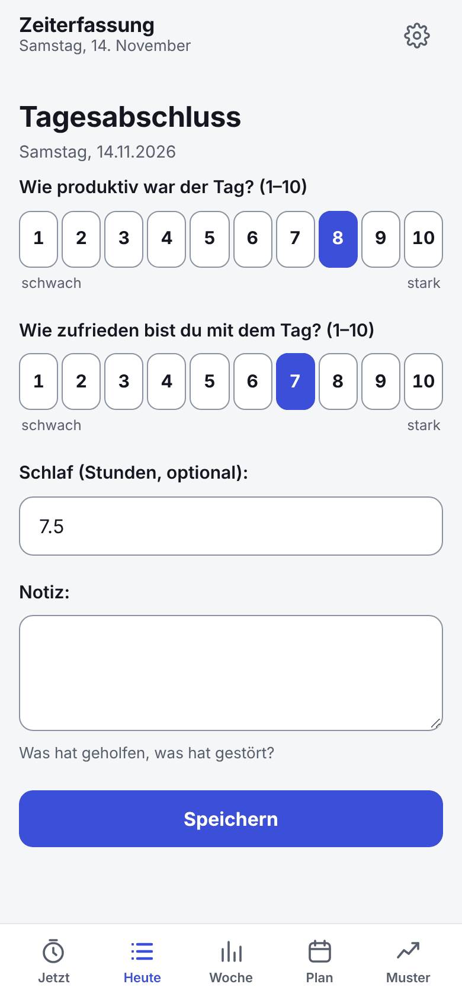
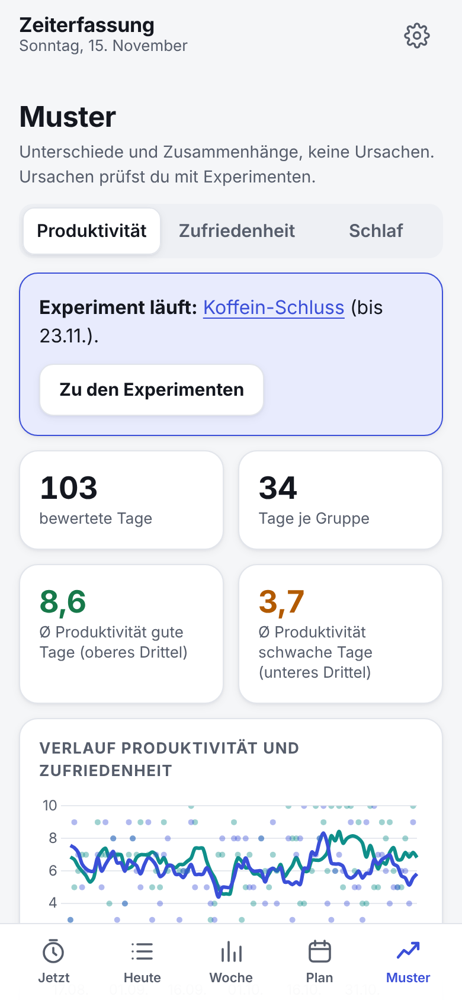
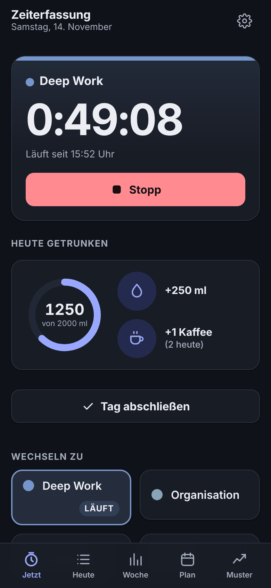
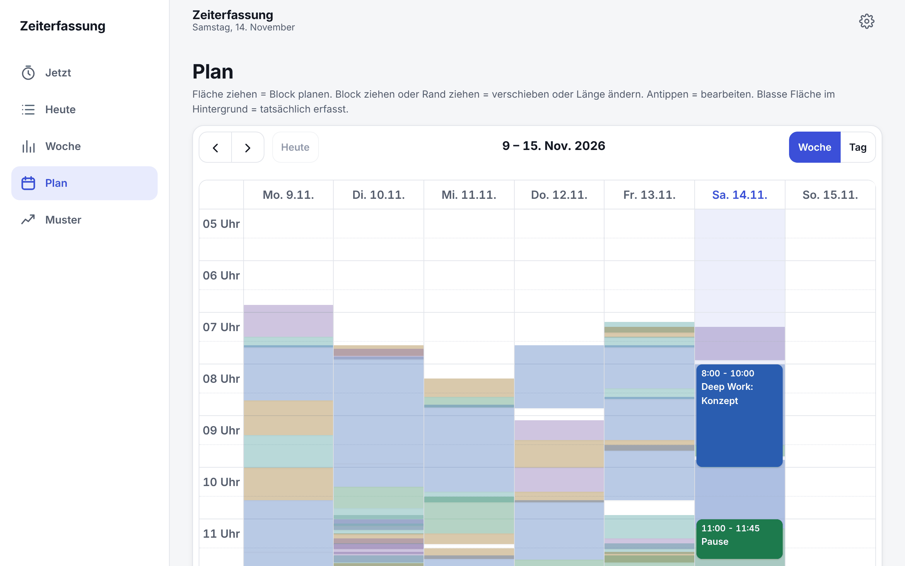

# Zeiterfassung

Persönliche Zeiterfassung mit Tagesauswertung. Über den Tag erfasst man Tätigkeiten, Pausen und
Trinkmenge (je ein Tipp), abends bewertet man den Tag mit zwei Scores: Produktivität und
Zufriedenheit. Daraus zeigt die App mit der Zeit, welche Muster gute von schwachen Tagen
unterscheiden. Die Ergebnisse sind Hypothesen („Unterschiede, keine Ursachen“).

Ziel, Architektur und Phasen: [docs/zielbild.md](docs/zielbild.md). Stand: Phase 0 bis 2,
Plan vs. Ist sowie API und MCP umgesetzt (Erfassen, Woche, Muster, Testdaten, Docker/CI,
Plankalender, JSON-API, MCP-Server). Als
Nächstes: Phase 3 (Korrelationen, Selbstexperimente). Der alte Prototyp liegt unverändert im Branch
`archiv-2021`.

## Screenshots

<table>
  <tr>
    <td></td>
    <td></td>
    <td></td>
  </tr>
  <tr>
    <td></td>
    <td></td>
    <td></td>
  </tr>
</table>

Desktop (ab 900 px Seitenleiste):




## Funktionen

- **Jetzt** (`/`): laufender Eintrag, ein Tipp auf eine Kategorie beendet den alten Block und
  startet den neuen. „Stopp“, „+250 ml Wasser“, „+1 Kaffee“ je ein Tipp.
- **Heute** (`/tag/`, `/tag/JJJJ-MM-TT/`): Zeitleiste (Tag = 04:00 bis 04:00 Uhr, schraffiert =
  nicht erfasst), Einträge bearbeiten, löschen, nachtragen, Messungen. Überschneidungen werden
  abgelehnt.
- **Abschluss** (`/tag/JJJJ-MM-TT/abschluss/`): „Wie produktiv war der Tag?“ und „Wie zufrieden
  bist du mit dem Tag?“ (je 1–10), Schlaf, Notiz. Erst danach erscheint die Zusammenfassung.
- **Woche** (`/woche/`, `/woche/JJJJ-MM-TT/`): Montag bis Sonntag, je Tag Zeitleiste, Deep-Work-
  Zeit und beide Scores.
- **Muster** (`/muster/?ziel=produktivitaet|zufriedenheit`): ab 14 bewerteten Tagen (letzte
  180 Tage) Vergleich des oberen und unteren Drittels nach der gewählten Zielgröße, je Merkmal
  Ø gute gegen Ø schwache Tage, stärkster Unterschied oben. Davor: „Noch N bewertete Tage bis
  zur ersten Auswertung“.
- **Plan** (`/plan/`, `?datum=JJJJ-MM-TT`): Wochenkalender (FullCalendar 6 per CDN, mobil
  Tagesansicht). Planblöcke per Ziehen anlegen, per Drag & Drop verschieben, Klick = bearbeiten
  oder löschen; erfasste Einträge erscheinen gestreift daneben. Planblöcke überschneiden sich
  nicht. In „Heute“ zeigt eine Tabelle je Kategorie-Art geplant gegen erfasst, sobald es
  Planblöcke gibt. Der Kalender braucht JavaScript.
- **Kategorien** haben eine Art: Deep Work, Shallow Work, Organisation, Pause, Freizeit.
  Pflege im Admin; `standardkategorien` legt Deep Work, Mails, Meetings, Organisation, Pause,
  Sport und Freizeit an.
- **Einstellungen** (`/einstellungen/`, Link im Kopf): API-Tokens erzeugen, auflisten, widerrufen.
- **API und MCP** (`/api/v1/`, `mcp_server/`): KI-Assistenten bedienen die Zeiterfassung, siehe
  „KI-Assistenten (MCP)“.
- Auf dem Handy als Web-App installierbar (Manifest). HTMX, FullCalendar und Chart.js (Diagramme in Woche und Muster) kommen per CDN mit fester Version.

## Installation

Drei Wege, alle aus demselben Code. Fertige Pakete entstehen bei jedem
[Release](https://github.com/alexknowsit/time_tracker/releases) (siehe „Release erstellen“).

### Windows (Installer)

1. `Zeiterfassung-Setup-X.Y.Z.exe` vom neuesten Release herunterladen und ausführen (kein
   Administrator nötig, Installation für den eigenen Nutzer).
2. „Zeiterfassung“ im Startmenü starten. Die App öffnet ein eigenes Fenster (Edge WebView2, auf
   Windows 10/11 vorhanden) und meldet den lokalen Nutzer automatisch an; ein Passwort gibt es
   nicht. Fenster schließen beendet sie.

Die Daten liegen unter `%LOCALAPPDATA%\Zeiterfassung` (`db.sqlite3`, `secret_key`). Eine
Deinstallation lässt sie bewusst stehen; für ein Backup den Ordner kopieren. Der Server lauscht nur
auf `127.0.0.1` an einem zufälligen Port; der Anmelde-Link mit einmaligem Geheimnis kennt nur das
Fenster, andere Programme auf dem Rechner kommen ohne ihn nicht hinein. Das Programm ist nicht
signiert: Beim ersten Start zeigt Windows SmartScreen eine Warnung („Weitere Informationen“, dann
„Trotzdem ausführen“). HTMX, FullCalendar und Chart.js kommen per CDN, die App braucht dafür
Internet (ohne sind Plan und Diagramme leer).

### Home Assistant (Add-on)

1. Einstellungen, Add-ons, Add-on-Store, Menü oben rechts, **Repositories**:
   `https://github.com/alexknowsit/time_tracker` hinzufügen.
2. **Zeiterfassung** installieren, starten, in der Seitenleiste öffnen (Ingress, kein Port).

Angemeldet ist, wer Home Assistant bedienen darf; Optionen (`zeitzone`,
`csrf_trusted_origins`), Datenablage und Sicherheit stehen in
[homeassistant/zeiterfassung/DOCS.md](homeassistant/zeiterfassung/DOCS.md). Das Add-on nutzt das
Image `ghcr.io/alexknowsit/time_tracker:<version>` (amd64 und arm64 in einem Multi-Arch-Manifest,
darum ohne `{arch}` in `image`). Die Add-on-Version in `config.yaml` setzt der Release-Workflow.

### Server (Docker Compose)

```
mkdir zeiterfassung && cd zeiterfassung
# docker-compose.yml vom Release und .env.example (zu .env) herunterladen
docker compose up -d
docker compose exec zeiterfassung python manage.py createsuperuser
docker compose exec zeiterfassung python manage.py standardkategorien <benutzername>
```

Die Compose-Datei (`deploy/docker-compose.yml`, als Release-Asset mit festem Tag) nutzt das Image
`ghcr.io/alexknowsit/time_tracker` statt `build: .`; `ZEITERFASSUNG_VERSION=X.Y.Z` legt die
Version fest. Konfiguration und HTTPS-Hinweise siehe „Docker“ und „Umgebungsvariablen“.

## Setup lokal

Voraussetzung: [uv](https://docs.astral.sh/uv/).

```
uv sync
export DJANGO_DEBUG=1
uv run python manage.py migrate
uv run python manage.py createsuperuser
uv run python manage.py standardkategorien <benutzername>
uv run python manage.py runserver   # App: http://127.0.0.1:8000/, Admin: /admin/
```

Prüfen vor jedem Commit:

```
uv sync --group mcp   # einmalig, damit die MCP-Tests laufen (sonst übersprungen)
uv run pytest
uv run ruff check && uv run ruff format
DJANGO_DEBUG=1 uv run python manage.py makemigrations --check --dry-run
```

## KI-Assistenten (MCP)

Der MCP-Server lässt Claude Code oder Claude Desktop die Zeiterfassung bedienen („starte Deep
Work“, „trage gestern 9 bis 10 Uhr Mails nach“, „wie war meine Woche?“). Er ruft die JSON-API
(`/api/v1/`) auf; die Tools heißen `aktueller_stand`, `timer_starten`, `timer_stoppen`,
`trinken_erfassen`, `eintrag_nachtragen`, `tag_abrufen`, `tag_bewerten`, `woche_abrufen`,
`muster_abrufen`, `plan_abrufen`, `planblock_anlegen`, `planblock_loeschen`.

1. In der App unter **Einstellungen** ein Token erzeugen und sofort kopieren (wird nur einmal
   angezeigt, gespeichert wird nur der Hash).
2. Claude Code (im Projektordner; ZEITERFASSUNG_URL ohne Schrägstrich am Ende):

```
claude mcp add zeiterfassung \
  --env ZEITERFASSUNG_URL=https://zeit.example.org \
  --env ZEITERFASSUNG_TOKEN=zt_... \
  -- uv run --project /pfad/zu/time_tracker --group mcp python /pfad/zu/time_tracker/mcp_server/server.py
```

   Claude Desktop (`claude_desktop_config.json`):

```json
{
  "mcpServers": {
    "zeiterfassung": {
      "command": "uv",
      "args": ["run", "--project", "/pfad/zu/time_tracker", "--group", "mcp",
               "python", "/pfad/zu/time_tracker/mcp_server/server.py"],
      "env": {
        "ZEITERFASSUNG_URL": "https://zeit.example.org",
        "ZEITERFASSUNG_TOKEN": "zt_..."
      }
    }
  }
}
```

Lokal zum Ausprobieren: `ZEITERFASSUNG_URL=http://127.0.0.1:8000`. Mit `--http [--port 8765]`
läuft der Server stattdessen als streamable-http auf `127.0.0.1` (ohne eigene Authentifizierung,
deshalb nur lokal binden). Ohne die beiden Variablen bricht er beim Start mit einer klaren
Meldung ab.

**Das Token wie ein Passwort behandeln:** Wer es hat, kann alle Daten lesen und ändern. Nicht
einchecken, nicht in Chats einfügen; bei Verdacht unter Einstellungen widerrufen. Der Assistent
sieht die Daten, die die Tools zurückgeben. Die API selbst: Header `Authorization: Bearer <token>`,
JSON rein und raus, Fehler als `{"fehler": …, "felder": {…}}`; Session-Logins gelten dort nicht.

## Testdaten

```
uv run python manage.py demodaten demo [--tage 42] [--seed 1]
```

Legt den Nutzer an, falls er fehlt (Passwort `demo`, wird ausgegeben), dazu die Standardkategorien
und für jeden Werktag bis gestern Einträge, Wasser-Messungen und beide Bewertungen. Eingebautes
Muster: frühe erste Pause, lange Deep-Work-Blöcke und mehr Wasser erhöhen die Produktivität;
mehr Pausen und weniger Wechsel erhöhen die Zufriedenheit (plus Rauschen). Mit gleichem `--seed`
immer gleiche Daten. Der Befehl bricht ab, wenn der Nutzer schon Einträge, Messungen oder
Bewertungen hat; echte und Testdaten werden nie gemischt. Am besten mit einer eigenen Datenbank
(`DJANGO_DB_PATH=/tmp/demo.sqlite3`).

## Docker

```
cp .env.example .env     # DJANGO_SECRET_KEY, DJANGO_ALLOWED_HOSTS, DJANGO_CSRF_TRUSTED_ORIGINS setzen
docker compose up -d --build
docker compose exec zeiterfassung python manage.py createsuperuser
docker compose exec zeiterfassung python manage.py standardkategorien <benutzername>
```

Der Container führt beim Start `migrate` aus und startet dann gunicorn auf Port 8000. Statische
Dateien liefert WhiteNoise aus, ein zusätzlicher Webserver dafür ist nicht nötig. Die
SQLite-Datei liegt im Volume `daten` unter `/data/db.sqlite3`; Backup = Datei kopieren.

Im Betrieb (`DJANGO_DEBUG` aus) sind Session- und CSRF-Cookie `Secure`, und `X-Forwarded-Proto`
wird vertraut. Die App gehört daher hinter einen HTTPS-Reverse-Proxy (z. B. Cloudflare), der
diesen Header selbst setzt und auf HTTPS umleitet. `manage.py check --deploy` meldet dann nur
noch `W004` (HSTS) und `W008` (SSL-Redirect), beides Aufgabe des Proxys.

## Umgebungsvariablen

| Variable | Bedeutung |
|---|---|
| `DJANGO_SECRET_KEY` | Pflicht, außer bei `DJANGO_DEBUG=1` (dann Dev-Default) |
| `DJANGO_DEBUG` | `1`/`true`/`yes` schaltet Debug ein, Standard: aus |
| `DJANGO_ALLOWED_HOSTS` | Kommagetrennte Hostnamen |
| `DJANGO_CSRF_TRUSTED_ORIGINS` | Kommagetrennte Ursprünge mit Schema (`https://…`), nur bei Debug aus |
| `DJANGO_DB_PATH` | Pfad der SQLite-Datei, Standard `db.sqlite3` im Projektordner (Docker: `/data/db.sqlite3`) |
| `ZEITERFASSUNG_MODUS` | `server` (Standard), `homeassistant` oder `desktop`. Ohne Angabe gilt `homeassistant`, wenn `/data/options.json` existiert. In den beiden anderen Modi entsteht der Schlüssel als Datei `secret_key` neben der Datenbank |

Die CI (`.github/workflows/ci.yml`) führt bei Push und Pull Request auf `main` ruff, pytest und
die Migrationsprüfung aus.

## Release erstellen

1. Auf `main` prüfen: pytest, ruff und Migrationsprüfung grün (CI).
2. Auf GitHub ein Release mit Tag `vX.Y.Z` veröffentlichen (Vorabversionen wie `v1.0.0-rc1`
   gehen auch, bekommen aber weder `:latest` noch einen Add-on-Versionssprung).
3. Der Workflow `.github/workflows/release.yml` läuft und erzeugt:
   - Docker-Image `ghcr.io/alexknowsit/time_tracker:X.Y.Z` und `:latest` (linux/amd64 und
     linux/arm64) und `docker-compose.yml` als Release-Asset,
   - `Zeiterfassung-Setup-X.Y.Z.exe` als Release-Asset (PyInstaller, Inno Setup, Rauchtest der
     gebauten App),
   - einen Commit auf `main` (`[skip ci]`), der `version` in
     `homeassistant/zeiterfassung/config.yaml` setzt und die Release-Notizen in dessen
     `CHANGELOG.md` einträgt; danach bietet Home Assistant das Update an.
4. Die Pakete einmal ausprobieren. Der erste Release braucht, dass das GHCR-Paket auf „public“
   steht (GitHub, Packages, Paketeinstellungen), sonst kann Home Assistant das Image nicht laden.

Zum Testen ohne Veröffentlichen: Actions, „Release“, „Run workflow“ (Version z. B. `0.0.0-test`).
Es wird nur gebaut, die Ergebnisse liegen als Workflow-Artifacts an der Ausführung. Der Push auf
`main` im letzten Schritt braucht Schreibrechte; ein Branchschutz muss dem Actions-Bot den Push
erlauben.

Windows-App lokal ausprobieren (ohne Fenster, gibt den Anmelde-Link aus):

```
uv run --group desktop python desktop/start.py --nur-server
```

Bauen: `DJANGO_SECRET_KEY=x uv run python manage.py collectstatic --noinput`, dann
`uv run --group desktop pyinstaller desktop/zeiterfassung.spec --noconfirm` und unter Windows
`iscc /DAppVersion=X.Y.Z desktop\zeiterfassung.iss`.
