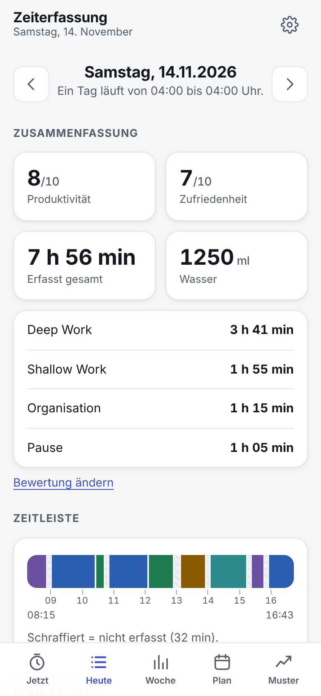
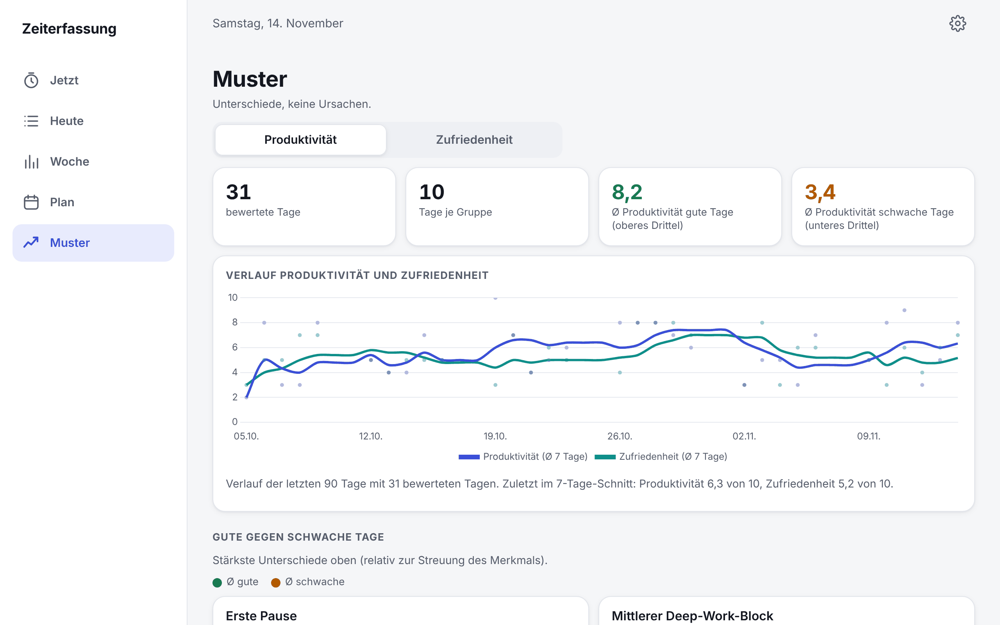

# Zeiterfassung

Persönliche Zeiterfassung mit Tagesauswertung. Über den Tag erfasst man Tätigkeiten, Pausen und
Trinkmenge (je ein Tipp), abends bewertet man den Tag mit zwei Scores: Produktivität und
Zufriedenheit. Daraus zeigt die App mit der Zeit, welche Muster gute von schwachen Tagen
unterscheiden. Die Ergebnisse sind Hypothesen („Unterschiede, keine Ursachen“).

Ziel, Architektur und Phasen: [docs/zielbild.md](docs/zielbild.md). Stand: Phase 0 bis 2,
Plan vs. Ist sowie API und MCP umgesetzt (Erfassen, Woche, Muster, Testdaten, Docker/CI,
Plankalender, JSON-API, MCP-Server), Phase 3 (Korrelationen, Selbstexperimente, Plan-Faktor,
Wochenbericht per MCP). Der alte Prototyp liegt unverändert im Branch
`archiv-2021`.

## Screenshots

<table>
  <tr>
    <td></td>
    <td></td>
    <td></td>
  </tr>
  <tr>
    <td></td>
    <td></td>
    <td></td>
  </tr>
  <tr>
    <td></td>
  </tr>
</table>

Desktop (ab 900 px Seitenleiste):




## Funktionen

- **Jetzt** (`/`): laufender Eintrag, ein Tipp auf eine Kategorie beendet den alten Block und
  startet den neuen. „Stopp“, „+250 ml Wasser“, „+1 Kaffee“ je ein Tipp.
- **Heute** (`/tag/`, `/tag/JJJJ-MM-TT/`): Zeitleiste (Tag = 04:00 bis 04:00 Uhr, schraffiert =
  nicht erfasst), Einträge bearbeiten, löschen, nachtragen, Messungen. Überschneidungen werden
  abgelehnt.
- **Abschluss** (`/tag/JJJJ-MM-TT/abschluss/`): „Wie produktiv war der Tag?“ und „Wie zufrieden
  bist du mit dem Tag?“ (je 1–10), „Fortschritt gemacht?“ (Ja/Nein), Abschalten (1–5, optional),
  Schlaf, Notiz. Erst danach erscheint die Zusammenfassung.
- **Woche** (`/woche/`, `/woche/JJJJ-MM-TT/`): Montag bis Sonntag, je Tag Zeitleiste, Deep-Work-
  Zeit und beide Scores.
- **Muster** (`/muster/?ziel=produktivitaet|zufriedenheit`): ab 14 bewerteten Tagen (letzte
  180 Tage) Vergleich des oberen und unteren Drittels nach der gewählten Zielgröße, je Merkmal
  Ø gute gegen Ø schwache Tage mit Cliff's Delta und Intervall, stärkster Unterschied oben.
  Ab 30 Tagen Korrelationen (Spearman, wochentagsbereinigt, Block-Bootstrap, Mehrfachtest nach
  Benjamini-Hochberg), ab 90 Tagen ein Mehrfachmodell (Ridge, Top 5, explorativ). Davor steht
  je Abschnitt, wie viele Tage noch fehlen. Alles sind Hypothesen, keine Ursachen; Grundlage:
  `docs/forschung.md`.
- **Experimente** (`/experimente/`): Selbstexperimente mit zufällig vorab zugewiesener Bedingung je
  Tag (tageweise, Blöcke, ABAB), acht Vorlagen mit Quelle, eigene Wenn-dann-Regeln. Hypothese,
  Zielgröße und Dauer sind nach dem Start fest, Abbruch nur mit Vermerk, höchstens ein Experiment
  läuft. Auf „Jetzt“ steht die heutige Bedingung, im Tagesabschluss die Frage nach der Einhaltung.
  Das Ergebnis (Randomisierungstest der Mediandifferenz, Cliff's Delta, Einhaltung) erscheint erst
  nach dem Ende und ist vorsichtig formuliert. Erreichbar über „Muster“ und die Seitenleiste.
- **Plan-Faktor** (auf „Plan“): Median Ist/Plan je Art der letzten 28 Tage („Deep Work: du schaffst
  im Median 70 % des Plans“), im Planblock-Dialog als „Realistisch: …“.
- **Plan** (`/plan/`, `?datum=JJJJ-MM-TT`): Wochenkalender (FullCalendar 6 per CDN, mobil
  Tagesansicht). Planblöcke per Ziehen anlegen, per Drag & Drop verschieben, Klick = bearbeiten
  oder löschen; erfasste Einträge erscheinen gestreift daneben. Planblöcke überschneiden sich
  nicht. In „Heute“ zeigt eine Tabelle je Kategorie-Art geplant gegen erfasst, sobald es
  Planblöcke gibt. Der Kalender braucht JavaScript.
- **Kategorien** haben eine Art: Deep Work, Shallow Work, Organisation, Pause, Freizeit.
  Pflege im Admin; `standardkategorien` legt Deep Work, Mails, Meetings, Organisation, Pause,
  Sport und Freizeit an.
- **Einstellungen** (`/einstellungen/`, Link im Kopf): API-Tokens erzeugen, auflisten, widerrufen,
  CSV-Export (`/export.csv`: eine Zeile je bewertetem Tag mit allen Merkmalen, Uhrzeiten als
  Minuten seit Mitternacht; `/export-eintraege.csv`: alle Einträge; Semikolon, UTF-8 mit BOM,
  Dezimalkomma).
- **API und MCP** (`/api/v1/`, `mcp_server/`): KI-Assistenten bedienen die Zeiterfassung, siehe
  „KI-Assistenten (MCP)“.
- Auf dem Handy als Web-App installierbar (Manifest). HTMX, FullCalendar und Chart.js (Diagramme in Woche und Muster) kommen per CDN mit fester Version.

## Setup lokal

Voraussetzung: [uv](https://docs.astral.sh/uv/).

```
uv sync
export DJANGO_DEBUG=1
uv run python manage.py migrate
uv run python manage.py createsuperuser
uv run python manage.py standardkategorien <benutzername>
uv run python manage.py runserver   # App: http://127.0.0.1:8000/, Admin: /admin/
```

Prüfen vor jedem Commit:

```
uv sync --group mcp   # einmalig, damit die MCP-Tests laufen (sonst übersprungen)
uv run pytest
uv run ruff check && uv run ruff format
DJANGO_DEBUG=1 uv run python manage.py makemigrations --check --dry-run
```

## KI-Assistenten (MCP)

Der MCP-Server lässt Claude Code oder Claude Desktop die Zeiterfassung bedienen („starte Deep
Work“, „trage gestern 9 bis 10 Uhr Mails nach“, „wie war meine Woche?“). Er ruft die JSON-API
(`/api/v1/`) auf; die Tools heißen `aktueller_stand`, `timer_starten`, `timer_stoppen`,
`trinken_erfassen`, `eintrag_nachtragen`, `tag_abrufen`, `tag_bewerten`, `woche_abrufen`,
`muster_abrufen`, `plan_abrufen`, `planblock_anlegen`, `planblock_loeschen`, `experiment_status`,
`experiment_starten`, `experiment_tag_bestaetigen`, `wochenbericht_daten` sowie der Prompt
`wochenbericht` (kurzer, vorsichtiger Rückblick mit Experiment-Vorschlägen, ohne Server-LLM).

1. In der App unter **Einstellungen** ein Token erzeugen und sofort kopieren (wird nur einmal
   angezeigt, gespeichert wird nur der Hash).
2. Claude Code (im Projektordner; ZEITERFASSUNG_URL ohne Schrägstrich am Ende):

```
claude mcp add zeiterfassung \
  --env ZEITERFASSUNG_URL=https://zeit.example.org \
  --env ZEITERFASSUNG_TOKEN=zt_... \
  -- uv run --project /pfad/zu/time_tracker --group mcp python /pfad/zu/time_tracker/mcp_server/server.py
```

   Claude Desktop (`claude_desktop_config.json`):

```json
{
  "mcpServers": {
    "zeiterfassung": {
      "command": "uv",
      "args": ["run", "--project", "/pfad/zu/time_tracker", "--group", "mcp",
               "python", "/pfad/zu/time_tracker/mcp_server/server.py"],
      "env": {
        "ZEITERFASSUNG_URL": "https://zeit.example.org",
        "ZEITERFASSUNG_TOKEN": "zt_..."
      }
    }
  }
}
```

Lokal zum Ausprobieren: `ZEITERFASSUNG_URL=http://127.0.0.1:8000`. Mit `--http [--port 8765]`
läuft der Server stattdessen als streamable-http auf `127.0.0.1` (ohne eigene Authentifizierung,
deshalb nur lokal binden). Ohne die beiden Variablen bricht er beim Start mit einer klaren
Meldung ab.

**Das Token wie ein Passwort behandeln:** Wer es hat, kann alle Daten lesen und ändern. Nicht
einchecken, nicht in Chats einfügen; bei Verdacht unter Einstellungen widerrufen. Der Assistent
sieht die Daten, die die Tools zurückgeben. Die API selbst: Header `Authorization: Bearer <token>`,
JSON rein und raus, Fehler als `{"fehler": …, "felder": {…}}`; Session-Logins gelten dort nicht.

## Testdaten

```
uv run python manage.py demodaten demo [--tage 120] [--seed 1]
```

Legt den Nutzer an, falls er fehlt (Passwort `demo`, wird ausgegeben), dazu die Standardkategorien
und für jeden Werktag (Wochenenden manchmal) bis gestern Einträge, Wasser- und Kaffee-Messungen
und die Bewertungen. Eingebautes Muster: frühe erste Pause, lange Deep-Work-Blöcke und mehr
Wasser erhöhen die Produktivität, unterbrochene Blöcke senken sie; mehr Pausen, weniger Wechsel
und Fortschritt (hängt mit langen Deep-Work-Blöcken zusammen) erhöhen die Zufriedenheit; später
Kaffee kostet Schlaf der folgenden Nacht (plus Rauschen). Dazu Bett-/Aufstehzeiten, einige
nachgetragene Einträge, Planblöcke der letzten 28 Tage (Deep Work etwa 70 % geschafft), ein
beendetes Experiment „Mikropausen“ (eingebauter Effekt auf die Zufriedenheit) und ein laufendes
„Koffein-Schluss“. Mit gleichem `--seed`
immer gleiche Daten. Der Befehl bricht ab, wenn der Nutzer schon Einträge, Messungen oder
Bewertungen hat; echte und Testdaten werden nie gemischt. Am besten mit einer eigenen Datenbank
(`DJANGO_DB_PATH=/tmp/demo.sqlite3`).

## Docker

```
cp .env.example .env     # DJANGO_SECRET_KEY, DJANGO_ALLOWED_HOSTS, DJANGO_CSRF_TRUSTED_ORIGINS setzen
docker compose up -d --build
docker compose exec zeiterfassung python manage.py createsuperuser
docker compose exec zeiterfassung python manage.py standardkategorien <benutzername>
```

Der Container führt beim Start `migrate` aus und startet dann gunicorn auf Port 8000. Statische
Dateien liefert WhiteNoise aus, ein zusätzlicher Webserver dafür ist nicht nötig. Die
SQLite-Datei liegt im Volume `daten` unter `/data/db.sqlite3`; Backup = Datei kopieren.

Im Betrieb (`DJANGO_DEBUG` aus) sind Session- und CSRF-Cookie `Secure`, und `X-Forwarded-Proto`
wird vertraut. Die App gehört daher hinter einen HTTPS-Reverse-Proxy (z. B. Cloudflare), der
diesen Header selbst setzt und auf HTTPS umleitet. `manage.py check --deploy` meldet dann nur
noch `W004` (HSTS) und `W008` (SSL-Redirect), beides Aufgabe des Proxys.

## Umgebungsvariablen

| Variable | Bedeutung |
|---|---|
| `DJANGO_SECRET_KEY` | Pflicht, außer bei `DJANGO_DEBUG=1` (dann Dev-Default) |
| `DJANGO_DEBUG` | `1`/`true`/`yes` schaltet Debug ein, Standard: aus |
| `DJANGO_ALLOWED_HOSTS` | Kommagetrennte Hostnamen |
| `DJANGO_CSRF_TRUSTED_ORIGINS` | Kommagetrennte Ursprünge mit Schema (`https://…`), nur bei Debug aus |
| `DJANGO_DB_PATH` | Pfad der SQLite-Datei, Standard `db.sqlite3` im Projektordner (Docker: `/data/db.sqlite3`) |

Die CI (`.github/workflows/ci.yml`) führt bei Push und Pull Request auf `main` ruff, pytest und
die Migrationsprüfung aus.
