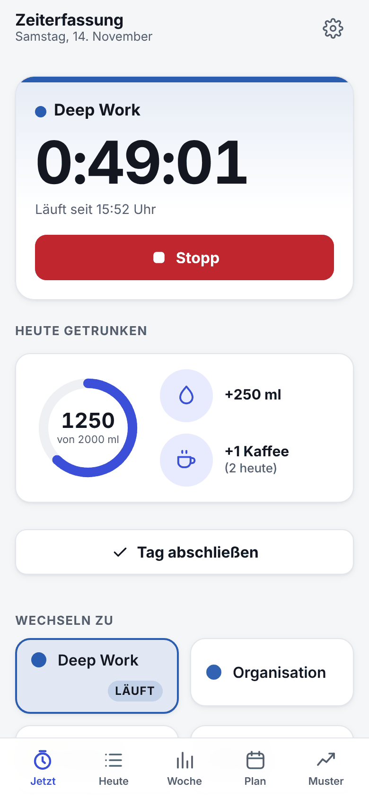
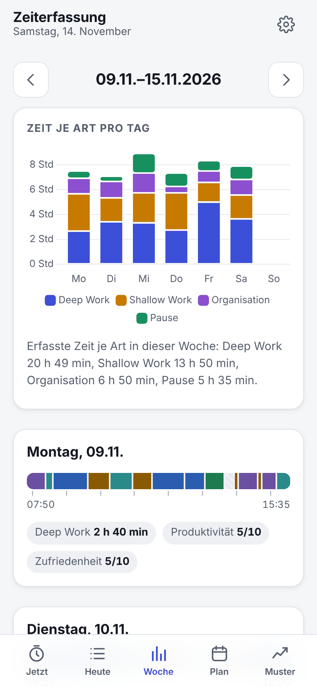
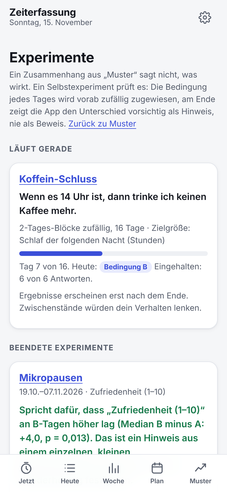

# Tagwerk

Personal time tracking with a daily review. During the day you log activities, breaks and water
intake (one tap each); in the evening you rate the day with two scores: productivity and
satisfaction. Over time the app shows which patterns separate good days from weak ones. Results
are hypotheses ("differences, not causes").

The UI, code identifiers, docs and commit messages are in German. This README is in English.

Goal, architecture and phases: [docs/zielbild.md](docs/zielbild.md) (German). Status: phases 0 to
3 are implemented (tracking, week view, patterns, demo data, Docker/CI, plan calendar, plan vs.
actual, JSON API, MCP server, correlations, self-experiments, plan factor, weekly report via
MCP). The old prototype is preserved unchanged in the `archiv-2021` branch.

## Screenshots

<table>
  <tr>
    <td></td>
    <td></td>
    <td></td>
  </tr>
  <tr>
    <td></td>
    <td></td>
    <td></td>
  </tr>
  <tr>
    <td></td>
  </tr>
</table>

Desktop (sidebar from 900 px):


## Features

URLs and UI labels are German (`JJJJ-MM-TT` = `YYYY-MM-DD`).

- **Jetzt** (`/`): the running entry. One tap on a category ends the old block and starts the new
  one. "Stopp", "+250 ml Wasser", "+1 Kaffee" are one tap each.
- **Heute** (`/tag/`, `/tag/JJJJ-MM-TT/`): timeline (day = 04:00 to 04:00, hatched = not
  tracked), edit, delete and backfill entries, measurements. Overlaps are rejected.
- **Abschluss** (`/tag/JJJJ-MM-TT/abschluss/`): "How productive was the day?" and "How satisfied
  are you with the day?" (1–10 each), "Made progress?" (yes/no), winding down (1–5, optional),
  sleep, note. The summary only appears afterwards.
- **Woche** (`/woche/`, `/woche/JJJJ-MM-TT/`): Monday to Sunday, per day a timeline, deep-work
  time and both scores.
- **Muster** (`/muster/?ziel=produktivitaet|zufriedenheit`): from 14 rated days (last 180 days)
  compares the top and bottom third by the chosen target; per feature the mean of good vs. weak
  days with Cliff's delta and interval, strongest difference first. From 30 days: correlations
  (Spearman, weekday-adjusted, block bootstrap, Benjamini-Hochberg multiple-testing correction);
  from 90 days a multi-feature model (ridge, top 5, exploratory). Before that, each section shows
  how many days are still missing. Everything is a hypothesis, not a cause; basis:
  `docs/forschung.md`.
- **Experimente** (`/experimente/`): self-experiments with a randomly pre-assigned condition per
  day (day-wise, blocks, ABAB), eight templates with sources, custom if-then rules. Hypothesis,
  target and duration are fixed after the start, aborting requires a note, at most one experiment
  runs at a time. "Jetzt" shows today's condition, the day review asks about adherence. The result
  (randomization test of the median difference, Cliff's delta, adherence) appears only after the
  end and is worded cautiously. Reachable via "Muster" and the sidebar.
- **Plan factor** (on "Plan"): median actual/planned per kind over the last 28 days ("Deep Work:
  you achieve a median of 70 % of the plan"), shown as "Realistisch: …" in the plan block dialog.
- **Plan** (`/plan/`, `?datum=JJJJ-MM-TT`): week calendar (FullCalendar 6, day view on mobile).
  Create plan blocks by dragging, move them by drag & drop, click to edit or delete; tracked
  entries appear striped next to them. Plan blocks do not overlap. "Heute" shows a table per
  category kind of planned vs. tracked once plan blocks exist. The calendar needs JavaScript.
- **Categories** have a kind: Deep Work, Shallow Work, Organisation, Pause, Freizeit. Managed in
  the admin; `standardkategorien` creates Deep Work, Mails, Meetings, Organisation, Pause, Sport
  and Freizeit.
- **Einstellungen** (`/einstellungen/`, link in the header): create, list and revoke API tokens,
  CSV export (`/export.csv`: one row per rated day with all features, times as minutes since
  midnight; `/export-eintraege.csv`: all entries; semicolon, UTF-8 with BOM, decimal comma).
- **API and MCP** (`/api/v1/`, `mcp_server/`): AI assistants can operate the tracker, see "AI
  assistants (MCP)".
- Installable as a web app on phones (manifest). HTMX, FullCalendar and Chart.js (charts in Woche
  and Muster) are vendored at fixed versions in `tracking/static/tracking/vendor/` (offline, with
  license files).

## Installation

Three ways, all from the same code. Ready-made packages are built with every
[release](https://github.com/alexknowsit/time_tracker/releases) (see "Creating a release").

### Windows (installer)

1. Download `Zeiterfassung-Setup-X.Y.Z.exe` from the latest release and run it (no administrator
   needed, installs for the current user).
2. Start "Zeiterfassung" from the Start menu. The app opens its own window (Edge WebView2, present
   on Windows 10/11) and signs in the local user automatically; there is no password. Closing the
   window quits the app.

Data lives in `%LOCALAPPDATA%\Zeiterfassung` (`db.sqlite3`, `secret_key`). Uninstalling
deliberately leaves it in place; for a backup, copy the folder. The server listens only on
`127.0.0.1` on a random port; the sign-in link with its one-time secret is known only to the
window, so other programs on the machine cannot get in without it. The program is not signed: on
first start Windows SmartScreen shows a warning ("More info", then "Run anyway"). HTMX,
FullCalendar and Chart.js are bundled, so the app runs completely offline.

### Home Assistant (add-on)

1. Settings, Add-ons, Add-on Store, menu at top right, **Repositories**: add
   `https://github.com/alexknowsit/time_tracker`.
2. Install **Zeiterfassung**, start it, open it from the sidebar (ingress, no port).

Whoever may use Home Assistant is signed in. Options (`zeitzone`, `csrf_trusted_origins`), data
location and security are described in
[homeassistant/zeiterfassung/DOCS.md](homeassistant/zeiterfassung/DOCS.md). The add-on uses the
image `ghcr.io/alexknowsit/time_tracker:<version>` (amd64 and arm64 in one multi-arch manifest,
hence no `{arch}` in `image`). The release workflow sets the add-on version in `config.yaml`.

### Server (Docker Compose)

```
mkdir zeiterfassung && cd zeiterfassung
# download docker-compose.yml from the release and .env.example (as .env)
docker compose up -d
docker compose exec zeiterfassung python manage.py createsuperuser
docker compose exec zeiterfassung python manage.py standardkategorien <username>
```

The compose file (`deploy/docker-compose.yml`, a release asset with a fixed tag) uses the image
`ghcr.io/alexknowsit/time_tracker` instead of `build: .`; `ZEITERFASSUNG_VERSION=X.Y.Z` pins the
version. For configuration and HTTPS notes see "Docker" and "Environment variables".

## Local setup

Requires [uv](https://docs.astral.sh/uv/).

```
uv sync
export DJANGO_DEBUG=1
uv run python manage.py migrate
uv run python manage.py createsuperuser
uv run python manage.py standardkategorien <username>
uv run python manage.py runserver   # App: http://127.0.0.1:8000/, Admin: /admin/
```

Check before every commit:

```
uv sync --group mcp   # once, so the MCP tests run (otherwise skipped)
uv run pytest
uv run ruff check && uv run ruff format
DJANGO_DEBUG=1 uv run python manage.py makemigrations --check --dry-run
```

## AI assistants (MCP)

The MCP server lets Claude Code or Claude Desktop operate the tracker ("start deep work", "log
yesterday 9 to 10 emails", "how was my week?"). It calls the JSON API (`/api/v1/`); the tools are
`aktueller_stand`, `timer_starten`, `timer_stoppen`, `trinken_erfassen`, `eintrag_nachtragen`,
`tag_abrufen`, `tag_bewerten`, `woche_abrufen`, `muster_abrufen`, `plan_abrufen`,
`planblock_anlegen`, `planblock_loeschen`, `experiment_status`, `experiment_starten`,
`experiment_tag_bestaetigen`, `wochenbericht_daten`, plus the prompt `wochenbericht` (a short,
cautious review with experiment suggestions, no server-side LLM).

1. In the app, create a token under **Einstellungen** and copy it immediately (shown only once,
   only the hash is stored).
2. Claude Code (in the project folder; `ZEITERFASSUNG_URL` without a trailing slash):

```
claude mcp add zeiterfassung \
  --env ZEITERFASSUNG_URL=https://zeit.example.org \
  --env ZEITERFASSUNG_TOKEN=zt_... \
  -- uv run --project /path/to/time_tracker --group mcp python /path/to/time_tracker/mcp_server/server.py
```

   Claude Desktop (`claude_desktop_config.json`):

```json
{
  "mcpServers": {
    "zeiterfassung": {
      "command": "uv",
      "args": ["run", "--project", "/path/to/time_tracker", "--group", "mcp",
               "python", "/path/to/time_tracker/mcp_server/server.py"],
      "env": {
        "ZEITERFASSUNG_URL": "https://zeit.example.org",
        "ZEITERFASSUNG_TOKEN": "zt_..."
      }
    }
  }
}
```

To try it locally: `ZEITERFASSUNG_URL=http://127.0.0.1:8000`. With `--http [--port 8765]` the
server runs as streamable-http on `127.0.0.1` instead (no authentication of its own, so bind
locally only). Without the two variables it aborts at startup with a clear message.

**Treat the token like a password:** whoever has it can read and change all data. Do not commit
it, do not paste it into chats; revoke it under Einstellungen if in doubt. The assistant sees the
data the tools return. The API itself: header `Authorization: Bearer <token>`, JSON in and out,
errors as `{"fehler": …, "felder": {…}}`; session logins do not count there.

## Demo data

```
uv run python manage.py demodaten demo [--tage 120] [--seed 1]
```

Creates the user if missing (password `demo`, printed), plus the default categories and, for every
weekday (weekends sometimes) up to yesterday, entries, water and coffee measurements and ratings.
Built-in pattern: an early first break, long deep-work blocks and more water raise productivity,
interrupted blocks lower it; more breaks, fewer switches and progress (correlated with long
deep-work blocks) raise satisfaction; late coffee costs sleep the following night (plus noise).
Also bed/wake times, some backfilled entries, plan blocks for the last 28 days (about 70 % of deep
work achieved), a finished experiment "Mikropausen" (built-in effect on satisfaction) and a running
one, "Koffein-Schluss". The same `--seed` always yields the same data. The command aborts if the
user already has entries, measurements or ratings; real and demo data are never mixed. Best used
with a separate database (`DJANGO_DB_PATH=/tmp/demo.sqlite3`).

## Docker

```
cp .env.example .env     # set DJANGO_SECRET_KEY, DJANGO_ALLOWED_HOSTS, DJANGO_CSRF_TRUSTED_ORIGINS
docker compose up -d --build
docker compose exec zeiterfassung python manage.py createsuperuser
docker compose exec zeiterfassung python manage.py standardkategorien <username>
```

On start the container runs `migrate` and then gunicorn on port 8000. WhiteNoise serves static
files, so no extra web server is needed. The SQLite file lives in the volume `daten` at
`/data/db.sqlite3`; backup = copy the file.

In production (`DJANGO_DEBUG` off) the session and CSRF cookies are `Secure` and
`X-Forwarded-Proto` is trusted. The app therefore belongs behind an HTTPS reverse proxy (e.g.
Cloudflare) that sets this header itself and redirects to HTTPS. `manage.py check --deploy` then
only reports `W004` (HSTS) and `W008` (SSL redirect), both the proxy's job.

## Environment variables

| Variable | Meaning |
|---|---|
| `DJANGO_SECRET_KEY` | Required, except with `DJANGO_DEBUG=1` (then a dev default) |
| `DJANGO_DEBUG` | `1`/`true`/`yes` enables debug, default: off |
| `DJANGO_ALLOWED_HOSTS` | Comma-separated host names |
| `DJANGO_CSRF_TRUSTED_ORIGINS` | Comma-separated origins with scheme (`https://…`), only with debug off |
| `DJANGO_DB_PATH` | Path of the SQLite file, default `db.sqlite3` in the project folder (Docker: `/data/db.sqlite3`) |
| `ZEITERFASSUNG_MODUS` | `server` (default), `homeassistant` or `desktop`. If unset, `homeassistant` applies when `/data/options.json` exists. In the other two modes the secret key is created as a file `secret_key` next to the database |

On push and pull request to `main`, CI (`.github/workflows/ci.yml`) runs ruff, pytest and the
migration check.

## Creating a release

1. On `main`, check that pytest, ruff and the migration check are green (CI).
2. Publish a release on GitHub with tag `vX.Y.Z` (pre-releases like `v1.0.0-rc1` work too, but get
   neither `:latest` nor an add-on version bump).
3. The workflow `.github/workflows/release.yml` runs and produces:
   - Docker image `ghcr.io/alexknowsit/time_tracker:X.Y.Z` and `:latest` (linux/amd64 and
     linux/arm64) and `docker-compose.yml` as a release asset,
   - `Zeiterfassung-Setup-X.Y.Z.exe` as a release asset (PyInstaller, Inno Setup, smoke test of
     the built app),
   - a commit on `main` (`[skip ci]`) that sets `version` in
     `homeassistant/zeiterfassung/config.yaml` and adds the release notes to its `CHANGELOG.md`;
     Home Assistant then offers the update.
4. Try the packages once. The first release requires the GHCR package to be "public" (GitHub,
   Packages, package settings), otherwise Home Assistant cannot pull the image.

To test without publishing: Actions, "Release", "Run workflow" (version e.g. `0.0.0-test`). It
only builds; results are workflow artifacts of the run. The push to `main` in the last step needs
write permission; branch protection must allow the Actions bot to push.

Try the Windows app locally (no window, prints the sign-in link):

```
uv run --group desktop python desktop/start.py --nur-server
```

Build: `DJANGO_SECRET_KEY=x uv run python manage.py collectstatic --noinput`, then
`uv run --group desktop pyinstaller desktop/zeiterfassung.spec --noconfirm` and on Windows
`iscc /DAppVersion=X.Y.Z desktop\zeiterfassung.iss`.
